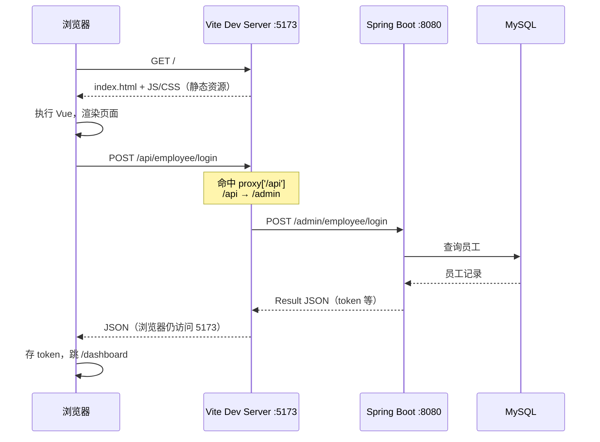

# 前后端请求链路：为什么访问前端地址能调后端

> 问题来源：访问 `http://localhost:5173` 看到的是前端页面，单独打开前端地址时它只是静态文件，
> 为什么登录时又能“接进”后端逻辑？
> 关联：[p3环境搭建](p3环境搭建.md)、[p3_登录态复盘](p3_登录态复盘.md)、[前端重构方案](../docs/p3/前端重构方案.md)。

## 1. 一句话回答

前端地址提供的是 **HTML / JS / CSS 静态资源**；浏览器把 JS 下载并执行后，页面里的 Axios
会再发一次 HTTP 请求到 `/api/...`，由 **Vite 开发代理（生产是 Nginx）** 转发到后端 8080。
所以不是“前端文件里连着后端”，而是 **页面运行起来后，由 JS 主动发请求**。

## 2. 分两段看

### 2.1 第一段：拿静态资源（没有后端参与）

```text
浏览器 GET http://localhost:5173/
  → Vite dev server 返回 index.html
  → 浏览器再请求 /src/main.js、样式、组件模块
  → Vue 挂载，渲染登录页
```

这一段只发生在 5173，后端 8080 完全没参与。断网、后端没启动，页面也能显示。

### 2.2 第二段：页面发接口请求（这时才进后端）

```text
点击登录
  → Axios POST /api/employee/login
  → 浏览器请求 http://localhost:5173/api/employee/login
  → Vite 命中 server.proxy['/api']，把 /api 改写成 /admin
  → Vite（服务端）请求 http://localhost:8080/admin/employee/login
  → Spring MVC 找到 EmployeeController.login
  → Service → Mapper → MySQL
  → 返回 Result{code:1,data:{token,...}}
  → Vite 把 JSON 原样返回给浏览器（浏览器看到的仍是 5173 同源）
```



关键点：**浏览器只认识 5173**，它不知道 8080 的存在；8080 是 Vite 在服务端转发过去的。
这样浏览器视角始终同源，不需要处理 CORS。

## 3. 开发与生产的差别

| 阶段 | 静态资源谁提供 | `/api` 谁转发 | 配置位置 |
|---|---|---|---|
| 开发 | Vite dev server（5173） | Vite `server.proxy` | [vite.config.js:13-23](../frontend/vite.config.js#L13-L23) |
| 生产 | Nginx（80，托管 `dist/`） | Nginx `location /api/` | [nginx.conf:67-71](../nginx/conf/nginx.conf#L67-L71) |

生产链路：

```text
浏览器 GET /                → Nginx → frontend/dist/index.html
浏览器 POST /api/employee/login
  → Nginx location /api/    → proxy_pass http://localhost:8080/admin/
  → Spring Boot
```

两种方式目标一致：**静态资源和接口都从同一个源访问，转发在服务端完成**。

## 4. 对应代码位置

| 环节 | 位置 | 说明 |
|---|---|---|
| 接口前缀 | [request.js:9-12](../frontend/src/api/request.js#L9-L12) | `baseURL: '/api'`，所有页面请求都走这里 |
| 开发代理 | [vite.config.js:13-23](../frontend/vite.config.js#L13-L23) | `/api` → `http://localhost:8080`，并把 `/api` 改写成 `/admin` |
| 生产代理 | [nginx.conf:67-71](../nginx/conf/nginx.conf#L67-L71) | `/api/` → `http://localhost:8080/admin/` |
| 后端入口 | [EmployeeController.java:42-61](../backend/sky-server/src/main/java/com/sky/controller/admin/EmployeeController.java#L42-L61) | 接收登录请求、生成 JWT |
| 鉴权拦截 | [JwtTokenAdminInterceptor.java:43-56](../backend/sky-server/src/main/java/com/sky/interceptor/JwtTokenAdminInterceptor.java#L43-L56) | 校验请求头 `token`，失败返回 401 |
| 环境变量 | [.env.development](../frontend/.env.development) | `VITE_API_BASE_URL=/api` |

## 5. 启动地址与命令

| 服务 | 地址 | 说明 |
|---|---|---|
| 前端开发服务器 | http://localhost:5173 | Vite，页面 + `/api` 代理 |
| 后端 API（直连） | http://localhost:8080/admin/... | 不经过代理，调试用 |
| Knife4j 接口文档 | http://localhost:8080/doc.html | 后端启动后访问 |
| Nginx（生产形态） | http://localhost | 当前仍指向旧产物 `html/sky`，接新 `dist` 属于阶段 7 |

```bash
# 后端：先安装三个模块，再从 sky-server 启动
cd backend
mvn -DskipTests install
mvn -f sky-server/pom.xml spring-boot:run

# 前端
cd frontend
npm run dev
```

> 不要用 `mvn -pl sky-server -am spring-boot:run`：它会在父 POM 上执行并报
> “Unable to find a suitable main class”。

当前本地配置（[application-dev.yml](../backend/sky-server/src/main/resources/application-dev.yml)）：
`database: sky_take_out_new`、`username: root`、`password:`（空口令）。
后端密码比对已改为 MD5（[EmployeeServiceImpl.java:52-59](../backend/sky-server/src/main/java/com/sky/service/admin/impl/EmployeeServiceImpl.java#L52-L59)），
因此数据库里的 `employee.password` 必须是 MD5；本地 `admin/123456` 对应的 MD5 是
`e10adc3949ba59abbe56e057f20f883e`。

## 6. 怎么判断“有没有接到后端”

打开浏览器 DevTools → Network，操作页面后看请求：

| 现象 | 含义 |
|---|---|
| 看到 `/api/employee/login`，200，响应 `code:1` | 链路通，后端返回成功 |
| 502 / `ECONNREFUSED` | 后端没启动，或 Vite 代理目标写错 |
| 404 | 路径改写不对，或后端没有该接口 |
| 401 | token 缺失/过期，被 `JwtTokenAdminInterceptor` 拒绝 |
| CORS 报错 | 请求绕过了代理（例如直接写了 `http://localhost:8080`） |

一句话：**页面能打开 ≠ 后端通了；只有 Network 里出现 `/api/...` 并拿到 JSON，才算真正联调成功。**
