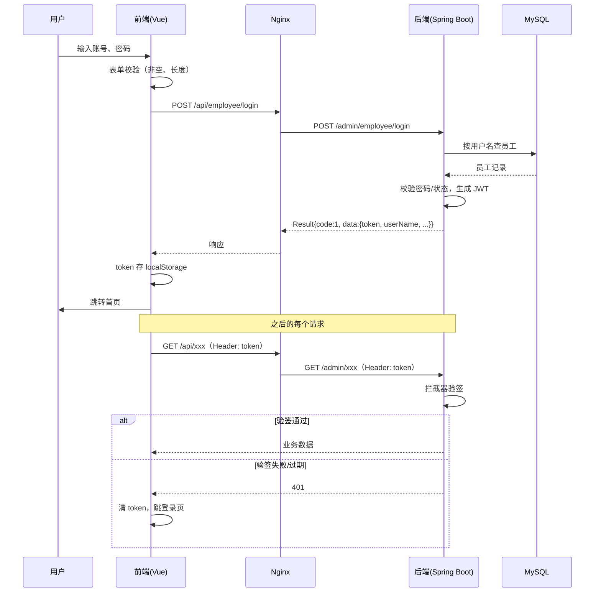

# 登录态复盘（JWT）

> 背景：前端重构方案评审时，对「登录态」不理解。本篇按「从输入到请求」的流向整理。
> 关联：[p3环境搭建](p3环境搭建.md)、[前端重构方案](../docs/p3/前端重构方案.md)。

## 1. 一句话

登录态 = 让**无状态的 HTTP 请求**在后续访问中能被后端认出「你是谁」。
本项目用 JWT：登录成功后后端发一个 token，前端之后每次请求都带上它，后端验签。

## 2. 为什么需要登录态

- HTTP 是无状态的：每个请求都是独立的，服务器不记得上一个请求是谁。
- 登录只发生一次，但后面每个接口都要知道：现在是谁、有没有登录、有没有权限。
- 两种主流做法：

| 做法 | 状态存在哪 | 特点 |
|---|---|---|
| Session + Cookie | 服务器 | 服务器保存 session；集群/跨域要额外处理 |
| **JWT（本项目）** | 客户端 | 服务器只验签、不存状态；无状态、易扩展；注销要额外机制 |

## 3. 全链路（从什么到什么）

对应的代码路径：

1. 前端提交 `{ username, password }`。
2. Nginx 把 `/api/` 改写成 `/admin/` 转给后端（`nginx/conf/nginx.conf:67-71`）。
3. 后端 `EmployeeController.login` 接收请求（`EmployeeController.java:42-61`）。
4. `EmployeeServiceImpl.login` 查库、校验密码和账号状态（`EmployeeServiceImpl.java:39-65`）。
5. 成功后生成 JWT，payload 里放 `empId`（`EmployeeController.java:48-53`）。
6. 返回 `Result<EmployeeLoginVO>`，`code = 1` 表示成功（`Result.java:14-38`）。
7. 前端保存 `token` 和用户信息，跳转首页。
8. 后续请求在请求头带 `token`。
9. 后端 `JwtTokenAdminInterceptor` 取头、验签、解析 `empId`；失败返回 401（`JwtTokenAdminInterceptor.java:42-56`）。
10. 前端收到 401：清 token、跳登录页。

## 4. JWT 里有什么

- 结构：`header.payload.signature`，三段用 `.` 连接。
- **payload 是可解码的明文**，JWT 只保证「没被篡改」，不保证「看不见」。所以不要放密码、手机号等敏感信息。
- 本项目 payload 只放 `empId`（`JwtClaimsConstant.EMP_ID`）。
- 过期时间由 `admin-ttl` 控制，当前配置 `7200000000` 毫秒 ≈ **83 天**（`application.yml:42`），偏长，后续建议缩短。
- 签名密钥 `admin-secret-key` 当前明文写在 `application.yml:40`，生产环境必须改成环境变量。

## 5. 前端怎么存、怎么带

| 问题 | 做法 | 说明 |
|---|---|---|
| 存哪 | `localStorage` | 简单、刷新不丢；缺点是 XSS 能读到，需要防 XSS |
| 怎么带 | 请求头 `token` | 与后端 `admin-token-name: token` 一致（`application.yml:44`） |
| 刷新页面 | 从 `localStorage` 恢复 | 路由守卫判断有没有 token |
| 过期/无效 | 收到 401 → 清 token → 跳登录 | 不自动续期 |
| 退出 | 前端清 token | 后端 `logout` 目前只返回成功，不维护黑名单（`EmployeeController.java:69-73`） |

## 6. 后端怎么验（以及当前代码的两个缺口）

拦截器逻辑（`JwtTokenAdminInterceptor.java:36-57`）：

1. 不是 Controller 方法的请求直接放行；
2. 从请求头取 `token`；
3. 用密钥验签、解析出 `empId`；
4. 验签失败 → 状态码 401。

**缺口 1**：拦截器解析了 `empId` 但没有写入 `BaseContext`（`JwtTokenAdminInterceptor.java:47-50` 只打了日志）。原始项目会把当前员工 id 放进 `BaseContext`，供 MyBatis 自动填充 `create_user` / `update_user` 使用；后续写业务接口时需要补上。

**缺口 2**：员工密码目前是明文比对（`EmployeeServiceImpl.java:53-56` 有 TODO），数据库里也是明文。后续要做 MD5/BCrypt 加密。

## 7. 常见疑问

| 疑问 | 回答 |
|---|---|
| 为什么登录一次，后面每个请求还要带 token？ | HTTP 无状态，服务器不记得上一次请求；token 就是每次自报身份。 |
| 为什么刷新页面还保持登录？ | token 存在 `localStorage`，刷新后读出来继续用。 |
| 只在前端判断有没有 token 够吗？ | 不够。前端判断只决定「页面跳不跳」，真正的门禁是后端拦截器。 |
| 退出后旧 token 还能用吗？ | 当前可以，直到过期。JWT 无状态，要做「立即失效」需要黑名单或短过期 + refresh token。 |
| 401 和 403 有什么区别？ | 401 = 没登录/令牌无效；403 = 登录了但没权限。本项目目前没有角色权限。 |
| 为什么开发环境不用处理跨域？ | Vite 代理把 `/api` 转给 8080；生产由 Nginx 同源转发。 |
| token 被偷了怎么办？ | HTTPS、防 XSS、缩短过期时间、退出/改密后让旧 token 失效。 |

## 8. 复盘结论

- 前端登录态 = 四件事：**存 token、带 token、处理 401、路由守卫**。
- 后端登录态 = 三件事：**验签、控制拦截范围、管理密钥和过期**。
- 当前待办（后端，不在本次前端方案范围）：
  - [ ] `admin-ttl` 缩短到合理时长；
  - [ ] 密钥改为环境变量；
  - [ ] 密码加密存储；
  - [ ] 需要时补 `BaseContext` 写入；
  - [ ] 需要「退出即失效」时加黑名单。
- 对应项目目标：接口设计（token 契约）、调试（401 定位）、文档阅读（配置与拦截器）。
